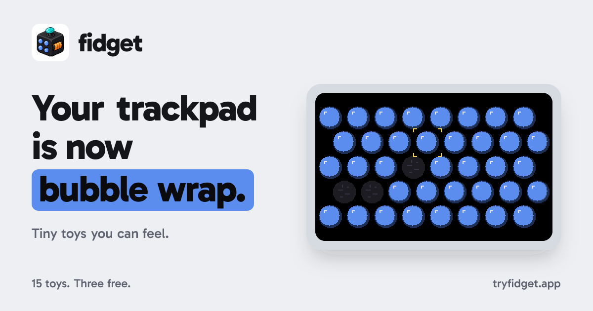
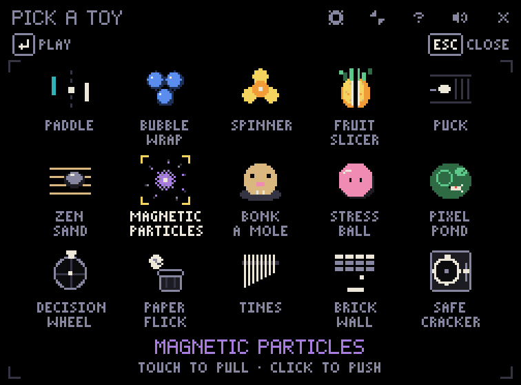

  

  
  

<strong>macOS 14+ · Apple silicon &amp; Intel · Signed &amp; notarized</strong> Three toys free. No subscription.

fidget is a tiny arcade that opens from your Mac's notch, over whatever you're doing. Pop bubbles while AI thinks, play a quick rally, or give restless hands something to do. Open, play, back.

This is the public home for **downloads, bug reports and ideas**. The app is proprietary; its source code stays private.

## Fifteen little ways to take a break

  

**Free, from the first download** 
Bubble Wrap · Paddle · Spinner

**Twelve more with the Arcade Pass** 
Fruit Slicer · Puck · Zen Sand · Magnetic Particles · Bonk a Mole · Stress Ball · Pixel Pond · Decision Wheel · Paper Flick · Tines · Brick Wall · Safe Cracker

The [Arcade Pass](https://tryfidget.app/#pass) is **$9.99 USD once, tax included**, for up to **3 Macs**. Try the free toys first and unlock the rest whenever you like.

## Make yourself a little arcade

1. [Download the DMG](https://tryfidget.app/download), open it and drag **fidget** into **Applications**.
2. Open fidget. Click the notch or press **Control–Option–P** to bring it up.
3. Pick a toy. Press **P** to get your pointer back, or **Esc** to leave.

A **Force Touch trackpad** gives you the tactile feel; every toy also works with a mouse. Displays without a notch get a stand-in at the top centre. Input Monitoring is only needed if you want the optional double-tap **Command** shortcut.

## Help make fidget better

Found a rough edge? Have an idea for something fun to feel on a trackpad? I'd love to hear it.

| What’s on your mind? | Start here |
| --- | --- |
| Something isn't working | [Report a bug](https://github.com/ruban-24/notchfidget-releases/issues/new?template=bug_report.yml) |
| A toy or game you'd love to play | [Suggest a toy or game](https://github.com/ruban-24/notchfidget-releases/issues/new?template=toy_idea.yml) |
| How it feels, what you like, what could improve | [Share feedback](https://github.com/ruban-24/notchfidget-releases/issues/new?template=feedback.yml) |

[Browse existing issues](https://github.com/ruban-24/notchfidget-releases/issues) first. If someone has already shared your idea, add a reaction or your experience there. Suggestions are welcome; they aren't a promise of future features.

**Licence, purchase or private support?** Email [support@tryfidget.app](mailto:support@tryfidget.app). Please keep licence keys, receipts and personal information out of public issues. You can also [recover your key through Polar](https://polar.sh/notchfidget/portal).

---

[Website](https://tryfidget.app) · [Download DMG](https://tryfidget.app/download) · [Release notes](https://github.com/ruban-24/notchfidget-releases/releases) · [Privacy](https://tryfidget.app/privacy) · [Terms](https://tryfidget.app/terms)

Made by [Ruban](https://github.com/ruban-24).
